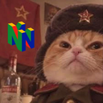

<p align="center">
  
</p>

# Our64

A Nintendo 64 emulator for the Wii U, running natively under [Aroma](https://aroma.foryour.cafe/).

Our64 is built on top of the shoulders of giants. Modified for the Wii U:

- [Not64](https://github.com/extremscorner/not64) by Extrems, from Wii64 and Mupen64: the CPU recompiler.
- [GLideN64](https://github.com/gonetz/GLideN64) by Gonetz and contributors: the graphics, with a new backend for the Wii U's GPU.
- [libgui](https://github.com/dborth/libgui) by Daryl Borth: the menus.

Used as they are:

- [CafeGLSL](https://github.com/Exzap/CafeGLSL) by Exzap: compiles the graphics shaders on the console.
- [mupen64plus](https://github.com/mupen64plus): the per-game settings database and the JPEG decoder. Fetch covers'
  table of header CRCs (`covertitles.c`) comes from its mupen64plus.ini too.
- [cxd4](https://github.com/cxd4/rsp)'s RSP interpreter and [miniLZO](https://www.oberhumer.com/opensource/lzo/) by Markus Oberhumer.
- [FatFs](https://elm-chan.org/fsw/ff/) by ChaN: reads USB drives.
- [libretro-thumbnails](https://github.com/libretro-thumbnails/libretro-thumbnails): the box art Fetch covers
  downloads, found by the No-Intro names in [libretro-database](https://github.com/libretro/libretro-database).

## What you need

- A Wii U with [Aroma](https://aroma.foryour.cafe/) installed.
- An SD card.
- Your own N64 game files (`.z64`, `.n64` or `.v64`). Our64 comes with no games.

## Install

1. Download the latest zip from [Releases](../../releases).
2. Copy its `wiiu` folder to the root of the SD card.
3. Copy your games into `sd:/wiiu/our64/roms`, the default ROM folder. To use another folder instead, on the
   SD card or on a FAT32 or exFAT USB drive, choose it in Settings > Games > ROM folder.
4. Start Our64 from the Wii U Menu.

## USB drives

- ROMs can be on a USB drive, but Our64 never writes to an external USB. Saves, save states and covers always stay on the SD card.
- Drives formatted for the Wii U can't hold ROMs.
- With ISFShax and stroopwafel's `5usbpart.ipx` plugin, Our64 can't see the drive's FAT32 partition, because
  the plugin shows homebrew only the Wii U partition. Use the plugin's SD build, `5upartsd.ipx`, instead: it
  makes that partition the SD card, and Our64 reads it as the SD card.

## Playing

- **Controllers:** GamePad, Pro Controller, Classic Controller, Wii Remote with or without a Nunchuk.
  Up to 4 players. Pair controllers in the Wii U Menu before starting Our64.
- **Resume:** Our64 keeps an autosave of where you stopped and offers it the next time you start the game.
  Turn it off in Settings > Games > Auto-Resume.
- **Paks:** Controller Pak, Rumble Pak and Transfer Pak. The Transfer Pak reads Game Boy saves from
  RetroArch's save folders, VBA GX's save folder and Game Boy Virtual Console games installed on the
  Wii U.

Files Our64 writes, all under `sd:/wiiu/our64`:

| Folder           | Holds                                            |
| ---------------- | ------------------------------------------------ |
| `saves/`         | in-game saves (cartridge saves, Controller Paks) |
| `states/`        | save states and the autosave                     |
| `config/`        | settings and button mappings                     |
| `art/`           | covers (Fetch covers)                            |
| `player-log.txt` | which games ran and how, errors, crashes         |

Error screens show a code such as `OUR-0104`. What each one means and how to fix it:
[docs/errors.md](docs/errors.md).

## Picture

Settings > Picture:

- **Screen mode:** TV only, TV + GamePad or GamePad only. The prompt at each start begins on this choice.
- **Shape:** 4:3, the games' own shape, or 16:9, stretched to fill a wide TV.

## Games

Settings > Games:

- **ROM folder:** where we find your games: `sd:/wiiu/our64/roms` unless you choose another.
- **Fetch covers:** downloads box art over Wi-Fi for games without any.
- **Auto-Resume:** On, the default, saves where you stop and picks up there next time. Off, every game
  starts at its title screen and no autosave is written. Turning it off deletes every game's autosave;
  save states stay.
- **Start-up ROM Category:** the category shown when Our64 starts: All, Recent or Favorites. Recent opens only
  when the last game played is in it, Favorites only when you have favorites; otherwise All.

## Reporting a problem

Open an [issue](../../issues/new/choose) and attach `sd:/wiiu/our64/player-log.txt` from the SD card.

---

## Building

1. Install devkitPro and its Wii U packages. On Ubuntu or Debian:
   
   ```
   sudo apt install git make curl xz-utils wget
   wget https://apt.devkitpro.org/install-devkitpro-pacman
   chmod +x install-devkitpro-pacman
   sudo ./install-devkitpro-pacman
   sudo dkp-pacman -S --needed wiiu-dev ppc-freetype ppc-libpng ppc-libjpeg-turbo ppc-bzip2 ppc-zlib
   ```
   
   Then log out and back in, so the build can find devkitPro. On Windows, macOS or another Linux, follow [devkitPro's guide](https://devkitpro.org/wiki/Getting_Started) and install the same packages.

2. Get the code and the shader compiler, then build:
   
   ```
   git clone https://github.com/Ch0nbo/Our64.git
   cd Our64
   tools/fetch-cafeglsl.sh
   make -C player RELEASE=1
   ```
   
   `tools/fetch-cafeglsl.sh` downloads [CafeGLSL](https://github.com/Exzap/CafeGLSL) (release
   v1.0.0-rc1) and checks its hash.

3. Copy `player/release/our64.wuhb` to `sd:/wiiu/apps/`.

Not64 and GLideN64 are included in `third_party/`, each with a `VENDORED.md` saying what changed.

To test a change:

```
make -C tests                                   # tests of the portable code, on the PC
make -C player                                  # developer build: player/our64.wuhb
WIIU_HOST=<console IP> tools/deploy-player.sh   # uploads it with FTPiiU; close Our64 first
```

The other scripts in `tools/` say what they do in their first lines.

## License

Our64's own code is GPL-2.0-or-later ([LICENSE](LICENSE)). The code in `third_party/` keeps its own license: Not64 and GLideN64 are GPL-2.0, CafeGLSL is MIT, FatFs R0.16 has its own BSD-style license.

## History

This repository starts at the first public release. Development before it happened in a private repository.
